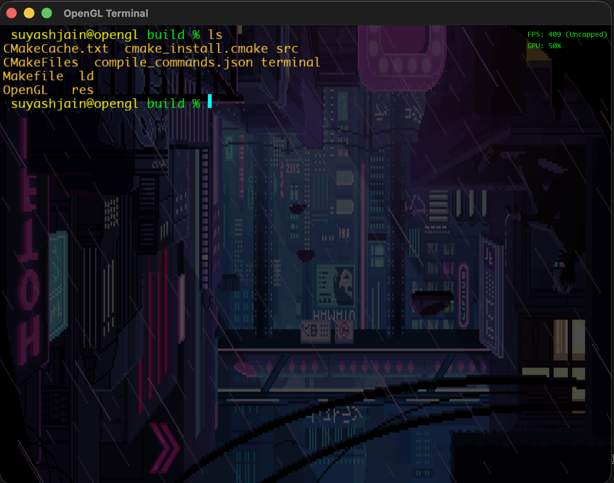

# TerminalGL

A terminal emulator that renders on the GPU, written in C++17 against OpenGL 3.3 core. It runs your real shell (zsh/bash) through a POSIX pseudo-terminal and draws every glyph from a single texture atlas in batched draw calls, so the CPU is left for the programs you're actually running.



## Results

Measured with VSync off (`F3`):

| | |
|---|---|
| Frame rate on a full screen of text | **460 FPS** |
| Frame draw time | **~2 ms** |
| Characters per draw call | **10,000+** (one call per run of same-colored text) |
| Output throughput vs. a CPU-rendered terminal, 700K+ lines | **~50% faster** |
| Input latency | **< 16 ms** |

## How it works

```
 shell (zsh/bash)
      │  forkpty(), non-blocking master fd
      ▼
 PTYHandler ──bytes──▶ Terminal ──glyphs──▶ Renderer ──1 VBO upload + glDrawArrays──▶ GPU
                       UTF-8 decode           batch of quads,
                       ANSI/CSI parser        flushed only when
                       line buffer + scroll   the color changes
                                  ▲
                       FontManager: FreeType glyphs packed on demand
                       into one 1024×1024 GL_RED atlas texture
```

### One texture for every glyph

The naive approach gives each character its own texture, which forces a texture bind and a draw call per character. `FontManager` instead rasterizes glyphs with FreeType the first time they're needed and packs them row by row into a single 1024×1024 single-channel atlas, recording each glyph's UV rectangle. Every character on screen therefore samples the same texture.

### Batch until the state changes

`Renderer` appends six vertices (position + UV) per glyph to a CPU-side buffer sized for 10,000 quads. Since the texture never changes, the only thing that forces a flush is a change of text color, a shader uniform. A screen of plain output is one `glBufferSubData` plus one `glDrawArrays`, and colored output costs one call per color run instead of one per character. The fragment shader reads the atlas's red channel as alpha and tints it.

### A real terminal underneath

`PTYHandler` spawns your `$SHELL` (with `TERM=xterm-256color`) using `forkpty()`, reads the master side non-blocking every frame, and forwards window resizes with `TIOCSWINSZ` so full-screen programs reflow. `Terminal` decodes UTF-8 incrementally (multi-byte sequences can split across reads) and runs a small state machine for escape sequences: cursor movement (`A`-`D`, `H`/`f`), SGR colors (`m`), and erase in display/line (`J`, `K`).

## Features

- Runs your shell over a PTY, with resize propagation
- UTF-8 decoding and ANSI color/cursor escape sequences
- Mouse-drag selection with copy (`Cmd+C`) and paste (`Cmd+V`) through the system clipboard
- Scrollback (`Shift+PgUp` / `Shift+PgDn`)
- Live zoom (`Cmd +` / `Cmd -`) that rescales the glyph grid
- Optional animated GIF background (`res/bg.gif`, decoded with `stb_image`)
- On-screen FPS counter; `F3` toggles VSync to measure uncapped frame rate

## Build

Requires CMake, GLFW 3.3+, FreeType and GLM. GLAD and `stb_image` are vendored.

```bash
brew install cmake glfw freetype glm   # macOS
cmake -S . -B build
cmake --build build
cd build && ./OpenGL
```

The shaders and `res/` are copied next to the binary at configure time, so run it from `build/`. The font is Monaco (macOS system font), with Arial as a fallback.

A PTY smoke test lives in `tests/test_pty.cpp`: it spawns a shell, sends a command and checks that the output comes back.

## Code map

| File | Role |
|---|---|
| `src/main.cpp` | Window and GL context, frame loop, input callbacks, FPS counter |
| `src/Renderer.*` | Vertex batching, flush-on-color-change, rectangle draws for cursor and selection |
| `src/FontManager.*` | FreeType loading and on-demand atlas packing |
| `src/Terminal.*` | Line buffer, UTF-8 decoder, ANSI/CSI parser, cursor, scrollback, selection |
| `src/PTYHandler.*` | `forkpty`, non-blocking I/O, window size |
| `src/Background.*` | Animated GIF background |
| `src/text.vs`, `src/text.fs` | Glyph shaders |

## Next

- Move color into a vertex attribute so mixed-color screens are also a single draw call
- Ligatures
- A config file for font, size and colors
